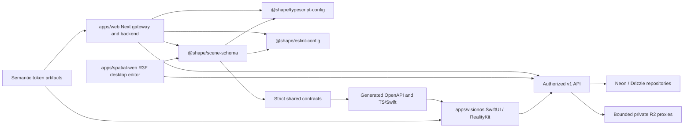

# Unified spatial creator platform

This document is the current architecture entry point. The [master prompt](../product/UNIFIED_PLATFORM_SPEC.md) describes the full product; the [Phase 0 audit and Phase 1 plan](../superpowers/plans/2026-11-12-unified-monorepo-foundation.md) scopes this increment. The product remains Shape Studio.

## Current application and package graph

One Next.js modular backend serves the conventional web UI, isolated A-Frame browser workspace and native SwiftUI/RealityKit app. Project identity, assets and permissions live on the server. Native canonical scenes and legacy A-Frame layouts currently use different representations; this foundation does not claim their complete synchronization.

The three JavaScript packages have actual consumers and explicit `workspace:*` dependencies. `packages/api-contract` and `packages/design-tokens` remain language-neutral artifact directories, without JavaScript manifests. Swift stays inside its native package/app or neutral codegen artifacts, never a TypeScript workspace package.

## Directory evolution

The web application and authoritative modular backend live in `apps/web`. The independently built Next application in `apps/spatial-web` provides the canonical desktop editor. The existing Xcode app remains in `apps/visionos`, independent of pnpm. Shared tooling and scene schemas remain consumed workspace packages; API/token outputs remain language-neutral artifacts.

The web application is the same-origin gateway. `/workspace` and `/workspace/:projectId` route to spatial-web; `/spatial-static/*` serves that app's collision-free Next assets. All existing `/api/*`, `/app/*`, `/studio/*`, `/xr/*`, public media and A-Frame vendor routes remain web-owned. Cross-application links perform full navigation. Spatial SSR forwards session transport to a configured web API origin with no-store fetches; API authorization remains authoritative. Browser writes and asset fetches stay relative to the public gateway origin.

Root `dev/start` starts and tears down both browser servers, `build` builds both, and `check` runs the shared validation graph. See [ADR 0004](../adr/0004-three-application-boundaries.md) and [setup/deployment](../development/local-setup.md). No empty domain packages or independent duplicate backend are introduced.

## Domain and interface boundaries

- [Domain model](domain-model.md): actual 22 tables, repositories and planned domains.
- [Authentication](authentication.md): Clerk cookie/native bearer identity and project authorization.
- [Scene format](scene-format.md): strict canonical v1, legacy layouts and future version migration.
- [Voice commands](voice-commands.md): existing deterministic proposals and the future shared command registry.
- [Realtime](realtime.md): current optimistic concurrency and planned presence/synchronization.
- [Web](../platforms/web.md), [browser XR](../platforms/browser-xr.md), [visionOS](../platforms/visionos.md): real platform responsibilities and limits.

Route handlers validate HTTP boundaries and delegate to repositories/application services. New domains should follow these boundaries rather than introducing duplicate backends or premature microservices. Provider/storage/auth keys remain server-only. No deployed database, provider account or hosting configuration was changed by Phase 1.
