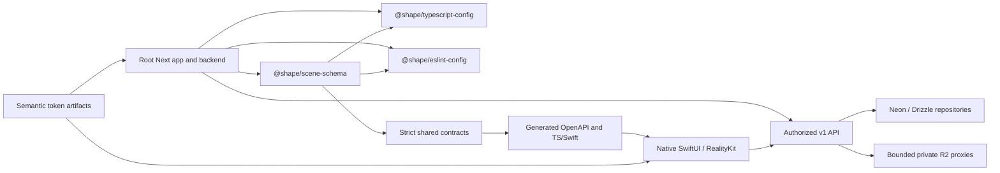

# Unified spatial creator platform

This document is the current architecture entry point. The [master prompt](../product/UNIFIED_PLATFORM_SPEC.md) describes the full product; the [Phase 0 audit and Phase 1 plan](../superpowers/plans/2026-11-12-unified-monorepo-foundation.md) scopes this increment. The product remains Shape Studio.

## Current application and package graph

One Next.js modular backend serves the conventional web UI, isolated A-Frame browser workspace and native SwiftUI/RealityKit app. Project identity, assets and permissions live on the server. Native canonical scenes and legacy A-Frame layouts currently use different representations; this foundation does not claim their complete synchronization.

The three JavaScript packages have actual consumers and explicit `workspace:*` dependencies. `packages/api-contract` and `packages/design-tokens` remain language-neutral artifact directories, without JavaScript manifests. Swift stays inside its native package/app or neutral codegen artifacts, never a TypeScript workspace package.

## Directory evolution

Today the working Next app remains at `src/`, with root configs, tests and deployment entry points. The native app remains at `apps/visionos`. Shared tooling and scene schemas are real workspace packages. Turbo registers root tasks for incremental adoption; root `dev`, `build`, `test` and database commands remain compatible.

The eventual layout is `apps/web`, `apps/spatial-web`, `apps/visionos`, consumed shared packages and justified worker runtimes. Move the root web app when a functional R3F client slice makes that boundary useful, with explicit environment/test/deployment migration. Do not add wrapper-only application manifests, empty realtime services or unused domain packages. [Decision record](../adr/0001-incremental-workspace.md).

## Domain and interface boundaries

- [Domain model](domain-model.md): actual 22 tables, repositories and planned domains.
- [Authentication](authentication.md): Clerk cookie/native bearer identity and project authorization.
- [Scene format](scene-format.md): strict canonical v1, legacy layouts and future version migration.
- [Voice commands](voice-commands.md): existing deterministic proposals and the future shared command registry.
- [Realtime](realtime.md): current optimistic concurrency and planned presence/synchronization.
- [Web](../platforms/web.md), [browser XR](../platforms/browser-xr.md), [visionOS](../platforms/visionos.md): real platform responsibilities and limits.

Route handlers validate HTTP boundaries and delegate to repositories/application services. New domains should follow these boundaries rather than introducing duplicate backends or premature microservices. Provider/storage/auth keys remain server-only. No deployed database, provider account or hosting configuration was changed by Phase 1.
