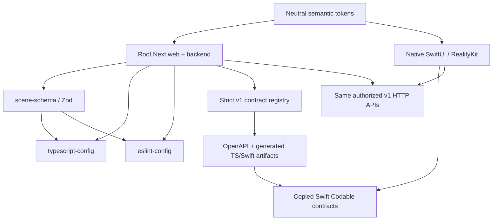

# Unified spatial platform foundation implementation plan

> For agentic workers: implement the bounded Phase 1 tasks after this audit is committed. Delegate independent documentation/CI work; root owns dependency installation, workspace configuration, integration tests and local commits.

**Goal:** Establish a genuine pnpm/Turborepo workspace around the working web/backend and native clients, preserving their behavior and contracts.

**Architecture:** Incrementally package consumed configuration and the pure scene schema. Keep the existing Next application at the root during this phase; keep Swift native and language-neutral generated artifacts outside JavaScript packages. Preserve one modular backend and current API/scene versions.

**Tech stack:** Existing Next 16.4.6, React 19.2.9, TypeScript 5.9.3, pnpm 11.12.0, Zod 4.6.7, Clerk/Drizzle/Neon/R2, A-Frame and native Swift 6.2/RealityKit. Add only a pinned Turborepo build-tool dependency and real workspace packages.

**Spec:** [Unified platform engineering prompt](../../product/UNIFIED_PLATFORM_SPEC.md). Scope here is Phase 0 plus Phase 1. Later phases are sequenced below; no R3F/realtime/organization integration is fabricated.

## Global constraints

- Preserve existing functionality and local history; use independently reviewable Conventional Commits.
- Shared project data is server-authoritative; no identity/storage/provider keys in clients.
- Native Swift is not a pnpm application and must not be a prerequisite for unrelated web changes.
- Create packages only with real responsibilities and consumers; do not create empty apps/services.
- Maintain strict TypeScript, schema validation and exact dependency pins.
- Scene v1 and generated native decoding remain wire-compatible. No new database migration is needed to establish workspace tooling.

## Phase 0 audit

Starting commit: `b251494`; primary checkout is clean. Reuse the isolated `/private/tmp/shape-spatial-native` worktree on `feat/unified-monorepo-foundation`. The prior native simulator launch and all app sources remain available in the primary checkout while this work proceeds.

Current implementations:

- Root Next App Router: conventional workspace, local image editor, project management and isolated browser A-Frame editor. Original Three recording lab has its own renderer.
- Shared modular backend: Clerk identity, SQL project permissions, 22 Drizzle tables and migrations 0000–0005, strict v1 contracts, private drafts, canonical scene CAS and bounded R2 proxies.
- Native Xcode app: hosted auth adapter, shared projects/assets/drafts/scenes, RealityKit volume and explicit immersive study. Previous verification is historical evidence, not a substitute for this phase's checks.
- Shared language-neutral API/token artifacts with generated TypeScript/Swift, independent Swift fixture and drift checks.
- Existing `pnpm-workspace.yaml` contains security policies but no workspace package list; no Turbo configuration or shared config packages exist.
- Existing CI runs native builds even for unrelated web-only changes.

Reuse: `src/server/db`, `src/server/auth`, `src/server/xr-assistant`, `src/server/providers`, strict `src/lib/contracts`, native services/renderer, existing shells and generated artifacts. The existing canonical scene schema is pure and can become a real shared package now.

Conflicts/gaps: no R3F primary editor; browser A-Frame uses separate legacy Euler layouts; native canonical v1 permits one scene/project and the viewer supports one compatible asset instance. No organization administration, asset conversion/upload pipeline, presence, durable conversations or complete deliverable workflow. Do not relabel personal workspaces as organizations or adapters as live-verified providers.

## Directory decision and dependency graph

Phase 1 executable structure:

```text
root Next app: src/, public/, tests/, scripts/, package.json
apps/visionos/: unchanged native Xcode project and Swift package
packages/scene-schema/: pure Zod v1 schema and orientation adapters
packages/typescript-config/: strict shared compiler configuration
packages/eslint-config/: shared flat ESLint configuration
packages/api-contract/: language-neutral artifacts, no JS package manifest
packages/design-tokens/: language-neutral tokens/artifacts, no JS manifest
docs/{architecture,product,platforms,api,adr,development}/
```

Target structure once corresponding functional slices are introduced:

```text
apps/web/             conventional Next app + modular backend
apps/spatial-web/     actual R3F editor; A-Frame isolated route/adapter
apps/visionos/        existing native app
packages/             scene-schema, config; then real api-client/ui/domain consumers
services/             only when a separate background runtime is justified
```

Moving the existing root application now would alter environment discovery, Drizzle paths, browser harness paths, token imports and deployment root without implementing a user-facing slice. Supported Turbo root tasks allow an incremental migration. A wrapper-only `apps/web` is explicitly rejected. R3F becomes primary for the future custom editor without replacing A-Frame in-place.



## Database and API definition

Retain the actual 22 tables: workspaces, workspace_members, projects, project_members, creative_drafts, spatial_scenes, brief_versions, artifact_versions, studio_sessions, assets, products, scene_state, xr_workspaces, content_versions, review_comments, review_decisions, access_grants, command_logs, claim_checks, processing_jobs, upload_events and rate_limit_buckets. Organization/client/task/deliverable domains are future additions with migration and tenant tests, not placeholder tables.

Retain current v1 project/list/assets/draft/capability/scene operations and the separate binary preview/native-content routes. OpenAPI remains generated from `ShapeApiSchemas`/`ShapeApiOperations`; publish a deterministic YAML-compatible mirror at `docs/api/openapi.yaml` using JSON syntax (JSON is a YAML 1.2 subset), without a second schema source or new YAML dependency.

Scene v1 remains `{sceneId,version:1,objects:[{id,assetId,position,rotation,scale,visible}]}`. Metres; right-handed +Y up, −Z forward; XYZW unit quaternions; no parent hierarchy in v1. The database save revision is separate from schema version. Strict installed Swift decoders reject added unknown keys. Future hierarchy/types/environment require explicit v2 contracts, tested one-way migration and loss-aware compatibility handling; no silent v1 rewrite.

## Implementation tasks

### 1. Real workspace/config/schema boundaries

Files: package.json, pnpm-workspace.yaml, turbo.json, .gitignore, tsconfig.json, eslint.config.mjs, next.config.ts; new package manifests/config files and `packages/scene-schema/src/index.ts`; existing spatial-scene module becomes a compatibility re-export.

- [ ] Preserve exact v1 schema behavior and existing imports while moving the implementation to `@shape/scene-schema`.
- [ ] Declare all internal dependencies as `workspace:*`; retain existing A-Frame override/build allowlist/release-age policies.
- [ ] Keep root dev/build/test/db commands compatible. Add a single Turbo `check` orchestration command using registered root tasks, without command recursion.
- [ ] Share strict TS options and ESLint rules through real config packages consumed by root and scene-schema. Keep app aliases/Next plugin/ignores at the app boundary.
- [ ] Keep native files out of JS workspace globs. Configure `.turbo/cache` explicitly per worktree.
- [ ] Preserve strict environment validation; Turbo must pass deployment markers and declared runtime configuration, without caching secret-dependent build outputs or database mutations.
- [ ] Verify frozen install, actual workspace/task graph, schema fixture behavior, environment guards and cache behavior. Existing scene/SQL/native fixtures must continue passing unchanged.

### 2. CI and executable architecture safeguards

Files: `.github/workflows/quality.yml`, `scripts/ci/changed-platforms.mjs`, focused classifier/workspace tests.

- [ ] Add a change-classification job with conservative fallback when the base is unavailable.
- [ ] Run web and native jobs independently; skip Xcode for unrelated web-only edits while shared contracts/tokens/native files trigger it.
- [ ] Test web-only/native/shared/workflow/initial-push cases. No untrusted event text interpolated as shell code.
- [ ] Check actual package exports and task dependencies, deployed-demo guard, frozen lockfile, generated mirrors and native-copy drift.

### 3. Documentation and validation

Files: requested architecture/platform/API/development documents, ADRs, README, AGENTS and both progress trackers; generator mirror updates.

- [ ] Write domain inventory, scene compatibility, auth, voice and realtime boundaries with implemented/planned distinctions.
- [ ] Document local setup/deployment and future directory moves; document measured test results and current limits.
- [ ] Run baseline/full unit+SQL tests, lint/types, drift, production build and browser regressions. Run Swift fixtures/core tests for unchanged scene transport compatibility; native rendering code is unchanged.
- [ ] Obtain an independent final architecture/security review and resolve material findings.
- [ ] Commit coherent changes locally, preserve initial history and make the clean branch available in the main checkout. No deployment or push.

## Review focus

1. Root task recursion or undeclared workspace dependencies must fail rather than silently omit checks.
2. Strict Turbo env filtering must not remove Vercel deployment markers and accidentally allow demo mode.
3. Extracting scene schemas must not change wire versions/constraints or pull renderers/server modules into the pure package.
4. Native CI classification must include shared contracts/tokens and unknown-base fallback without gating unrelated web edits.
5. Generated artifacts/docs must have one source and deterministic drift checks; no stale schema mirror or Swift inside JS packages.

## Subsequent milestones

2: organization/project domain additions and typed clients using existing backend; 3: functional briefs/assets/conversations; 4: explicit scene v2/history/renderer interfaces; 5: actual R3F editor and canonical browser/native persistence slice; 6: deterministic shared command registry and native speech capture; 7: extend existing native renderer/sync; 8: authorized presence and review; 9: profiling, live account/device acceptance and deployment hardening. Each requires its own plan, reviewable implementation and evidence. Phase 1 does not claim the ten-step integrated MVP is complete.
